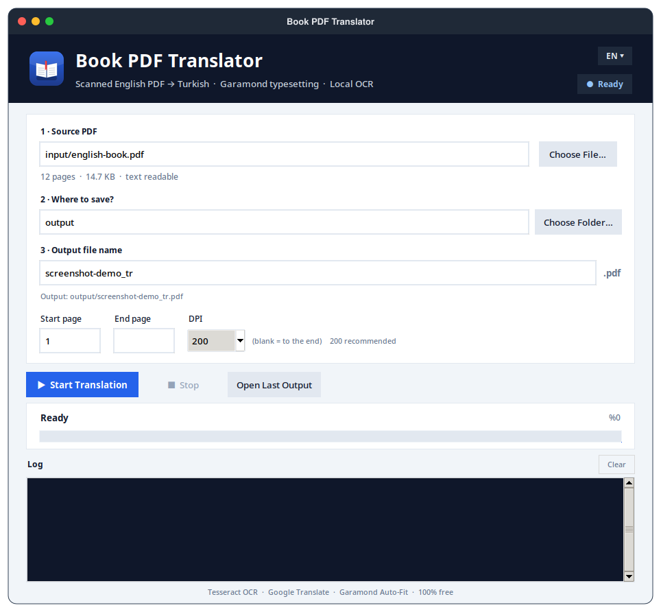

<h1 align="center">YourBook YourLanguage</h1>

<p align="center">Translate scanned English book PDFs into Turkish while preserving the page layout, with local OCR and Garamond typesetting.</p>

## Screenshots

<p align="center">
  
</p>

## Features

- Converts scanned or image-only English PDFs with local Tesseract OCR
- Translates English to Turkish with a SQLite cache and an automatic fallback endpoint
- Rebuilds each page with Garamond auto-fit typesetting and OpenCV background cleaning
- Resumes interrupted books from a checkpoint file
- Desktop interface with Turkish and English UI, page range, DPI, progress and log
- Handles 500-1000 page books with streamed page rendering
- Runs on Linux with Python 3 and Tkinter; requires Tesseract OCR and Poppler

## Installation

Build and run from source:

```bash
git clone https://github.com/colgecen/YourBook-YourLanguage.git
cd YourBook-YourLanguage
./yourbook-yourlanguage --install
```

`--install` is a one-time step that lets you type `yourbook-yourlanguage` (no `./`) to open the build menu:

```bash
yourbook-yourlanguage
```

Prebuilt binaries are available on the [Releases](https://github.com/colgecen/YourBook-YourLanguage/releases) page.

## Usage

Run the app straight from source (press `Ctrl+C` to stop):

```bash
./yourbook-yourlanguage
```

The desktop window opens on the English-to-Turkish workspace. Select a source PDF, choose the output folder and file name, set the page range and DPI, then click **Start Translation**. Use the language menu at the top right to switch the interface between Turkish and English; OCR and translation always run from English to Turkish. Progress, warnings and errors appear in the log panel.

Configuration lives in `~/.config/yourbook-yourlanguage/config.json`.

## License

This project is licensed under the [MIT](LICENSE) license.
